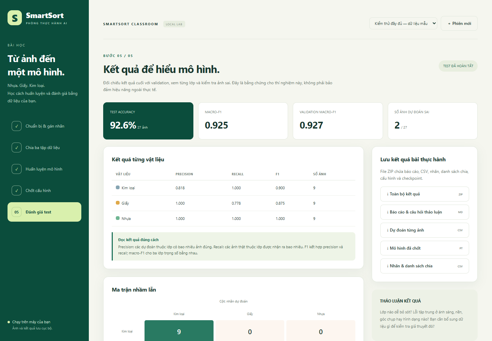

# SmartSort Classroom — huấn luyện, chốt mô hình và đánh giá test

**Sản phẩm chính: giao diện local dùng dạy học với ảnh chưa có nhãn.** Backend Python/FastAPI, giao diện HTML/CSS/JavaScript, mô hình EfficientNet-B0. Notebook Colab cũ bên dưới được giữ nguyên làm ví dụ với dữ liệu đã có nhãn.

## Chạy giao diện local

Hướng dẫn đầy đủ cho người mới: **[Clone repo → tạo môi trường → cài đặt → chạy](docs/CAI_DAT_VA_CHAY.md)**. Repo public; người dùng có thể clone mà không cần được cấp quyền GitHub.

Chạy nhanh trên Windows PowerShell (CPU):

```powershell
git clone https://github.com/buide03/smartsort-colab-lab.git
cd smartsort-colab-lab
python -m venv .venv
.\.venv\Scripts\python.exe -m pip install --upgrade pip
.\.venv\Scripts\python.exe -m pip install torch torchvision --index-url https://download.pytorch.org/whl/cpu
.\.venv\Scripts\python.exe -m pip install -r requirements.txt
.\.venv\Scripts\python.exe run_local.py
```

Mở **http://127.0.0.1:8000**. Giữ cửa sổ Python mở; `Ctrl+C` để dừng. Nếu đã tải ZIP local, bỏ hai lệnh clone/cd và mở terminal tại thư mục đã giải nén. Cổng khác: `.\.venv\Scripts\python.exe run_local.py --port 8001`.

Linux/macOS:

```bash
git clone https://github.com/buide03/smartsort-colab-lab.git
cd smartsort-colab-lab
python3 -m venv .venv
./.venv/bin/python -m pip install --upgrade pip
./.venv/bin/python -m pip install -r requirements.txt
./.venv/bin/python run_local.py
```

Python 3.10+, khuyến nghị 3.11/3.12; chạy được CPU, có CUDA thì dùng GPU. Lần đầu cần Internet để cài thư viện và tải trọng số ImageNet. Giao diện không dùng CDN; dữ liệu/nhãn/kết quả lưu tại `.smartsort/` và không push lên Git.

1. **Tải ảnh & gán nhãn:** mọi ảnh bắt đầu chưa có nhãn. Chọn Nhựa/Giấy/Kim loại hoặc Bỏ qua; có xem lớn, lọc ảnh, gán theo nhóm, tải CSV.
2. **Chia ba tập:** mặc định 70/15/15 theo từng lớp; lưu seed/manifest, khóa nhãn và giữ kín ảnh test.
3. **Huấn luyện & validation:** thử learning rate, xem learning curves, early stopping và checkpoint tốt nhất. Không đọc test.
4. **Chốt cấu hình:** chọn cấu hình đạt tiêu chí validation đặt trước; lưu checkpoint, epoch, ngưỡng và hash bản chia.
5. **Đánh giá test:** chỉ suy luận bằng checkpoint đã chốt; metrics từng lớp, confusion matrix, ảnh sai, nhận xét và ZIP báo cáo/mô hình.

Mỗi bước có giải thích và câu hỏi thảo luận. Xem [hướng dẫn dạy học, kịch bản buổi học và rubric](docs/HUONG_DAN_DAY_HOC.md), [kiểm thử local](docs/KIEM_THU_LOCAL.md). Tải [gói local](SmartSort_Local_App.zip) nếu không dùng Git clone.

Cần tối thiểu 10 ảnh khác nhau/lớp, khuyến nghị từ 50 ảnh/lớp. Ứng dụng không đoán nhãn từ thư mục/metadata, chỉ loại ảnh có pixel trùng hoàn toàn; ảnh gần giống/cùng vật thể cần kiểm tra thủ công. Bài toán phân loại toàn bộ ảnh, không phát hiện nhiều vật thể hay lớp unknown. Sau khi xem test và cải tiến, cần test mới độc lập.



Mã local: `smartsort_app/`, `run_local.py`, `start_local.ps1`. Kiểm tra: `pip install httpx`, rồi `python -m unittest discover -s tests -p test_workflow.py -v`. `tests/verify_browser.py` dùng Edge/Playwright và mô hình thật để kiểm thử toàn quy trình với nhãn tham chiếu làm fixture; ứng dụng không tự đọc nhãn đó.

## Notebook Colab phiên bản trước

[](https://colab.research.google.com/github/buide03/smartsort-colab-lab/blob/main/SmartSort_Lab/SmartSort_Colab_Lab.ipynb)

Lab dùng EfficientNet-B0 pretrained ImageNet, huấn luyện classifier ba lớp, chọn checkpoint bằng validation rồi đánh giá test. Có fine-tuning tùy chọn, early stopping, phân tích lỗi và xuất kết quả.

## Chạy trên Google Colab

1. Tải [notebook](SmartSort_Lab/SmartSort_Colab_Lab.ipynb) và [ZIP dữ liệu chia sẵn](SmartSort_Lab/SmartSort_Data_Split.zip).
2. Mở notebook bằng nút Colab ở trên, hoặc mở https://colab.research.google.com/ → **File → Upload notebook**.
3. Chọn **Runtime → Change runtime type → T4 GPU**, rồi **Run all**.
4. Khi được hỏi, upload `SmartSort_Data_Split.zip`. Cũng có thể dùng [ZIP gốc](SmartSort_Lab/SmartSort_Dataset_Original.zip); notebook tự chia validation theo cùng seed.
5. Kết thúc, tải `SmartSort_Results.zip` chứa báo cáo, biểu đồ, dự đoán và checkpoint.

## Dữ liệu và kết quả chạy thử

| Tập | Số ảnh |
|---|---:|
| Train | 96 |
| Validation | 24 |
| Test ba lớp | 60 |
| Test ngoài lớp: thủy tinh, carton | 15 |

Lần chạy CPU đã đạt validation accuracy 100%, test accuracy 78.33%, macro-F1 test 0.769. Test basic đạt 93.33%, variation đạt 63.33%. Đây là dữ liệu nhỏ phục vụ thực hành; chi tiết giới hạn và các yếu tố đánh giá ở [báo cáo kiểm thử](SmartSort_Lab/KET_QUA_KIEM_THU.md).

## Nội dung repo

- [Hướng dẫn lab](SmartSort_Lab/README.md).
- [Notebook](SmartSort_Lab/SmartSort_Colab_Lab.ipynb), [mã nguồn các cell](SmartSort_Lab/lab_source.py), [script tạo notebook và chia dữ liệu](SmartSort_Lab/build_notebook.py).
- ZIP dữ liệu gốc, ZIP chia train/validation/test và [gói lab đầy đủ](SmartSort_Lab/SmartSort_Lab_Colab_Full.zip).
- [Kết quả chạy thử đầy đủ](SmartSort_Lab/verified_run/SmartSort_Results.zip), [checkpoint](SmartSort_Lab/verified_run/outputs/best_model.pt), [báo cáo tự động](SmartSort_Lab/verified_run/outputs/REPORT.md), CSV và biểu đồ trong `SmartSort_Lab/verified_run/outputs/`.

## Chạy trên máy tính

```powershell
python -m pip install -r requirements.txt
$env:SMARTSORT_ZIP = (Resolve-Path 'SmartSort_Lab/SmartSort_Data_Split.zip').Path
python -X utf8 SmartSort_Lab/lab_source.py
```

Trên Linux/macOS:

```bash
python -m pip install -r requirements.txt
SMARTSORT_ZIP=SmartSort_Lab/SmartSort_Data_Split.zip python SmartSort_Lab/lab_source.py
```

Kết quả tại `local_runtime/outputs/`. Để tạo lại notebook và ZIP chia sẵn: `python SmartSort_Lab/build_notebook.py`; có thể chỉ định ZIP khác bằng `--zip PATH`.

Nguồn dữ liệu: TrashNet, Gary Thung; giấy phép MIT của bộ dữ liệu được giữ trong các ZIP. Tài liệu mô hình: [Torchvision EfficientNet-B0](https://docs.pytorch.org/vision/stable/models/generated/torchvision.models.efficientnet_b0.html).
