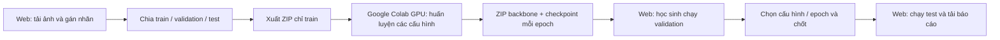

# SmartSort: train Colab → validation/test trên web Railway

## Luồng triển khai



Web không phải GPU server Colab và không có kết nối runtime dài hạn. Hai bên trao đổi bằng ZIP, nên có thể triển khai bằng một dịch vụ Docker CPU với volume. Validation/test luôn ở web; **gói gửi Colab chỉ có train**. Gói mô hình phải khớp phiên, kế hoạch train và hash bản chia.

Colab lưu classifier từng epoch; học sinh chạy validation trên web để chọn epoch và cấu hình tốt nhất. Không có early stopping bằng validation trên Colab vì không gửi validation lên đó. Các tiêu chí chọn mô hình được đặt trước khi xuất gói.

## 1. Deploy lên Railway từ repo

1. Đăng nhập [Railway](https://railway.com/), tạo project và chọn **Deploy from GitHub repo**.
2. Chọn repo **buide03/smartsort-colab-lab**, nhánh `main`, thư mục gốc `/`. Railway dùng `Dockerfile` và `railway.json` trong repo. Đây là dịch vụ web CPU; không cần GPU ở Railway.
3. Thêm **Volume** gắn với dịch vụ, mount path **`/data`**. Volume giữ ảnh, nhãn, checkpoint, validation/test và báo cáo qua các lần redeploy; cấu hình mount bằng giao diện Railway, `railway.json` không tự tạo volume.
4. Trong **Variables**, đặt:

| Biến | Giá trị |
|---|---|
| `SMARTSORT_APP_DATA` | `/data/sessions` |
| `SMARTSORT_ALLOW_LOCAL_TRAIN` | `false` |
| `PORT` | `8000` |
| `SMARTSORT_CLASSROOM_PASSWORD` | Mã lớp do giáo viên đặt, chia sẻ riêng cho học sinh |

5. Giữ **1 replica / 1 worker** vì hàng đợi tác vụ và file phiên nằm cùng process/volume. Không thêm lệnh chạy nhiều worker. Entrypoint có sẵn `python serve.py`; nếu Railway yêu cầu start command, dùng lệnh này.
6. Deploy và chờ healthcheck **`/healthz`** đạt. Lần build đầu cài CPU PyTorch có thể mất thời gian; chưa có URL dùng được cho đến khi dịch vụ deploy thành công.
7. Vào **Settings → Networking → Public Networking → Generate Domain**, target port **8000**. Railway cấp URL HTTPS dạng `https://<tên-được-cấp>.up.railway.app`. Dùng URL thật được hiển thị, không lấy hostname ví dụ này làm địa chỉ của lớp.
8. Mở URL bằng trình duyệt. Nếu đã đặt mã lớp, đăng nhập Basic Auth với username **`class`**, password là mã lớp. Gửi URL và mã lớp cho học sinh.

[Dockerfile trên Railway](https://docs.railway.com/guides/docker-compose), [Volume](https://docs.railway.com/volumes), [Generate Domain](https://docs.railway.com/networking/public-networking), [cấu hình Railway](https://docs.railway.com/config-as-code/reference).

Ứng dụng là phòng học dùng chung: các phiên ở cùng server xuất hiện trong danh sách, chưa có tài khoản/quyền riêng cho từng học sinh. Giáo viên giao mỗi nhóm một phiên có tên rõ ràng; không dùng server này để lưu dữ liệu cá nhân. Mã lớp kiểm soát truy cập toàn phòng học, không tách quyền giữa các nhóm. Một tác vụ validation/test chạy tại một thời điểm; nhóm khác cần chờ lượt. Nếu cần nhiều lớp với dữ liệu riêng, deploy từng dịch vụ/volume riêng.

## 2. Thao tác giáo viên và học sinh

### Trên web

1. Tạo phiên, tải ảnh và gán nhãn hoặc Bỏ qua ảnh ngoài ba lớp.
2. Chia train/validation/test và kiểm tra số lượng từng lớp.
3. Bước 3: đặt learning rates, dropout, số epoch, số phiên bản ảnh train, tiêu chí validation và confidence threshold.
4. Bấm **Tải gói train cho Colab**, lưu `SmartSort_Colab_Train.zip`.

### Trên Colab

5. Bấm **Mở notebook Colab**, hoặc [mở notebook train mới](https://colab.research.google.com/github/buide03/smartsort-colab-lab/blob/main/colab/SmartSort_Train_Colab.ipynb).
6. Chọn **Runtime → Change runtime type → T4 GPU**; chạy các cell theo thứ tự. Notebook kiểm tra GPU và dừng nếu chưa có CUDA, không âm thầm train CPU.
7. Upload `SmartSort_Colab_Train.zip` khi notebook yêu cầu. Không upload ZIP toàn bộ ba tập thay cho gói này.
8. Sau khi train, tải `SmartSort_Colab_Models.zip`. Gói chứa backbone đóng băng, classifier mỗi epoch, lịch sử train và metadata, chưa có kết quả validation/test.

[Cách upload/download file trong Colab](https://colab.research.google.com/notebooks/io.ipynb).

### Quay lại web — học sinh đánh giá

9. Mở **đúng phiên** đã xuất train. Bấm **Nhập mô hình Colab**, chọn `SmartSort_Colab_Models.zip`.
10. Bấm **Chạy validation trên web**. Ứng dụng dùng validation để kiểm tra mọi epoch/cấu hình, đề xuất epoch có macro-F1 cao nhất, nếu bằng chọn loss thấp hơn.
11. Sang bước **Chốt cấu hình**, giải thích lý do chọn, chọn cấu hình đạt tiêu chí rồi bấm chốt.
12. Sang **Đánh giá test**, bấm mở test. Chỉ checkpoint đã chốt được suy luận, không cập nhật trọng số.
13. Đọc accuracy, precision/recall/F1, confusion matrix, ảnh sai và confidence; tải ZIP báo cáo/CSV/mô hình.

Sau test không nhập mô hình mới, chạy validation lại hoặc train lại trong cùng phiên. Cải tiến sau khi xem test cần một tập test mới độc lập. Xuất lại gói train tạo request mới; gói mô hình của request cũ sẽ bị từ chối.

## 3. Docker trên máy để chạy thử trước deploy

Cài Docker Desktop/Engine và khởi động engine. Trong thư mục repo:

```bash
docker compose up --build -d
docker compose logs -f
```

Mở `http://localhost:8000`. Nếu cổng 8000 đang do bản Python local dùng, dừng bản đó hoặc đổi port phía host trong `compose.yaml` thành `8001:8000` rồi mở port 8001.

```bash
docker compose down
```

Lệnh trên dừng container và giữ volume. Để giữ dữ liệu bài học, **không thêm `-v`**. Volume `smartsort_data` lưu phiên. Bản Docker tắt train local; validation/test dùng CPU. Muốn mã lớp trên máy, thêm `SMARTSORT_CLASSROOM_PASSWORD` vào environment của dịch vụ bằng cấu hình riêng, không commit mật khẩu.

## 4. Vận hành

- Volume `/data` phải gắn trước khi dùng để bảo toàn dữ liệu qua redeploy. Sao lưu volume hoặc tải kết quả ZIP trước thay đổi dịch vụ.
- Theo dõi tài nguyên/build/deploy trong Railway; nhu cầu phụ thuộc số ảnh, số nhóm và số checkpoint. CPU PyTorch vẫn cần bộ nhớ dù train đã chuyển sang Colab.
- GPU Colab do tài khoản/runtime Colab cấp phát, có thể không sẵn có; ứng dụng không cam kết tài nguyên Colab hay tự tạo runtime.
- Học sinh không cần cài Python hoặc Docker để dùng URL web. Người train trên Colab cần tài khoản Google và runtime GPU.
- Healthcheck không yêu cầu mã lớp; các trang/API còn lại dùng mã lớp nếu biến password được đặt.
- Không có migration tài khoản/hạ tầng Google Cloud trong bản này. Nếu chuyển Google Cloud, cần thiết kế lưu trữ bền vững phù hợp; file phiên không được giữ trên filesystem tạm của container sau khi mất instance.

## Trạng thái xác minh

Code Colab, kiểm tra gói, validation và test được xác minh bằng mô hình thật trên CPU ở môi trường phát triển, với chế độ CPU chỉ dành cho script kiểm thử. Notebook dành cho người dùng vẫn yêu cầu CUDA. Không tuyên bố đã chạy hosted Colab GPU hoặc deploy Railway khi chưa thực hiện trong tài khoản tương ứng. Docker cần build thực tế bằng engine đang hoạt động; kiểm tra cú pháp/entrypoint không thay cho một lần build/deploy.
